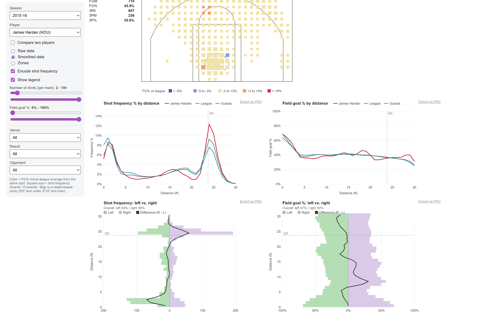
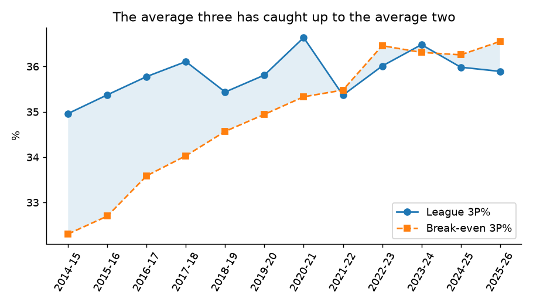
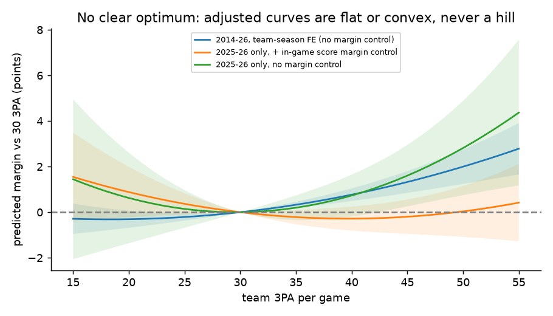
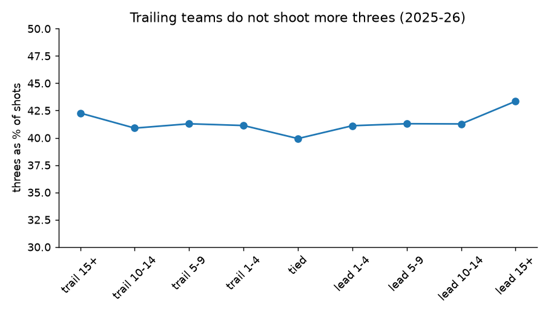
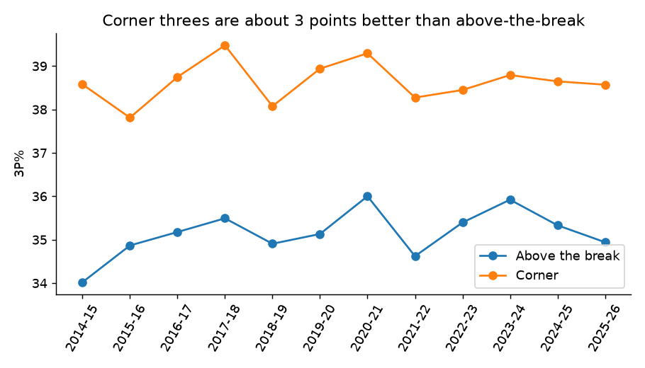
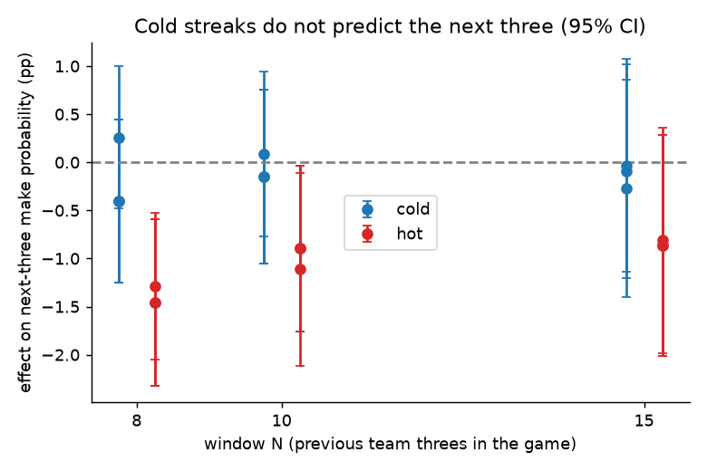

# Optimal 3-Point Shooting (NBA)

How many threes should an NBA team take, how accurate must a shooter be for his threes to help, and does being "cold" make the next shot worse? This project answers those questions with public NBA.com data (via [`nba_api`](https://github.com/swar/nba_api)) from 2014-15 to 2025-26. It started from one anecdote, the Spurs' 17-of-43 night in Game 4 of the 2026 Finals, and tests whether it says anything general.

**Interactive explorer:** `streamlit run app.py` (filter and sort teams, players and lineups; change the cold-streak definition; break-even calculator). It runs from the committed summary tables, so no data pull is needed.

**Shot explorer (Buckets-style player charts):** the "Shot charts" tab in the Streamlit app, or a standalone static page in `docs/shot_explorer/` (serve it with `python -m http.server -d docs/shot_explorer` and open http://localhost:8000, or host it on GitHub Pages). Court map (raw, smoothed, zones), shot frequency and FG% by distance against the league and a position group, left vs right splits, home/away, win/loss and opponent filters, and two-player comparison, for every player-season since 2014-15 with at least 100 attempts. Colors show FG% minus the league average from the same spot. Guards/forwards/bigs is a height-based proxy.



## Results at a glance

| Question | Answer | Confidence |
|---|---|---|
| What 3P% breaks even against an average two? | 32.3% in 2014-15, 36.6% in 2025-26. League 3P% sat at 35-36.6%, so the average three is now worth about the same as the average two. | High (description of every shot) |
| Is there an optimal number of team 3PA? | **No clear optimum.** The adjusted curve is flat or weakly convex, never a hill, and the "trailing teams chase with threes" explanation did not hold up. | Inconclusive |
| Does a cold stretch predict the next three? | **No.** Effects are within about one point for windows of 8 to 15 threes; there is no hot hand either. The Spurs split is within chance. | Null result, one season |
| What mix of shooters and other roles is best? | No sign of diminishing returns; role effects are confounded with player quality; clusters overlap heavily. | Exploratory |

### 1. The average three has caught up to the average two


League volume rose from 27% to 41% of shots over the same period: teams kept shooting threes until the average one was worth about the same as the average two (-0.02 points per attempt in 2025-26).

### 2. No clear optimum number of threes


Team-season fixed effects, opponent strength and home court are held fixed. Estimates cover only about 15 to 55 attempts. Even with an in-game score margin control (2025-26 play-by-play), no hill appears.

### 3. Trailing teams do not shoot more threes


This removes the most obvious explanation for the odd curve in the box-score models.

### 4. Corner threes are about 3 points better


38.6% from the corners against 35% above the break, stable across seasons.

### 5. Cold streaks do not predict the next three


Cold = the team's 3P% over its previous N threes in the game is at most 25% (N = 8, 10, 15; fixed before looking at results). Controls: shooter, distance, zone, score margin. Both "cold" and "hot" effects are within about one point.

## Run it

```
python -m venv .venv
.venv\Scripts\activate          # macOS/Linux: source .venv/bin/activate
pip install -r requirements.txt
streamlit run app.py            # works immediately: uses data/app/ (committed)
```

To regenerate everything from scratch (about 2 hours of API calls, mostly one-time and cached):

```
python src/pull_gamelogs.py     # team game logs (minutes)
python src/pull_shots.py        # shot-level data (about 20 min)
python src/pull_pbp.py 2025-26  # play-by-play (about 40 min)
python src/pull_roles.py        # player stats and lineups (about 20 min)
python src/build_notebooks.py   # only if you want to rebuild notebooks 01 and 02 from source (clears outputs)
python src/build_followups.py   # notebooks 03 to 05
python src/build_app_data.py    # summary tables for the app (about 6 min)
python src/build_shot_chart_data.py  # shot-chart tables for the Shot charts tab and docs/shot_explorer (about 1 min)
python src/make_figures.py      # README charts
```

Raw API responses are cached in `data/raw/` (gitignored); every pull script skips requests that are already cached. The combined tables in `data/processed/` (about 67 MB) are also gitignored: they are rebuilt by the pull scripts, and the small summaries the app needs (under 1 MB) are committed in `data/app/`.

## Layout

- `app.py` Streamlit explorer
- `src/` pulling scripts, shared helpers (`features.py`), notebook sources (`*_cells.py`), `build_app_data.py`, `make_figures.py`
- `notebooks/01_q1_optimal_3pa.ipynb` Q1 team 3PA curve (box scores)
- `notebooks/02_q2_breakeven.ipynb` Q2 break-even 3P%, zones, player volume
- `notebooks/03_q1b_margin_control.ipynb` Q1 follow-up with score margin (2025-26 play-by-play)
- `notebooks/04_cold_streak.ipynb` cold-streak test
- `notebooks/05_q3_roles_lineups.ipynb` player roles and lineup net rating
- `writeup.md` full project log with every check; `nba_3pt_project.md` the original plan
- `docs/figures/` README charts; `data/app/` committed summary tables

## Method notes and limits

- Observational data: all results are associations. Good teams shoot more threes partly because they are good, which is why the models use team-season fixed effects and opponent strength.
- No defender or "openness" information; shot quality is proxied by zone and distance only.
- Play-by-play covers one season (2025-26). In-game average margin is partly an outcome of the game, so margin-controlled models are robustness checks, not causal estimates.
- NBA.com endpoints silently truncate some league-wide requests (shot charts and lineups at 100k/2,000 rows); the scripts pull team by team and check totals against box scores.
- Q3 roles come from k-means with weak cluster separation (silhouette 0.21) and are descriptive.

## Data and licence

Data comes from NBA.com's public stats API through `nba_api` and is not redistributed in raw form here; the committed summary tables are aggregates. Check NBA.com's terms before reusing the data commercially. No licence has been chosen yet; add one before publishing if you want others to reuse the code.
